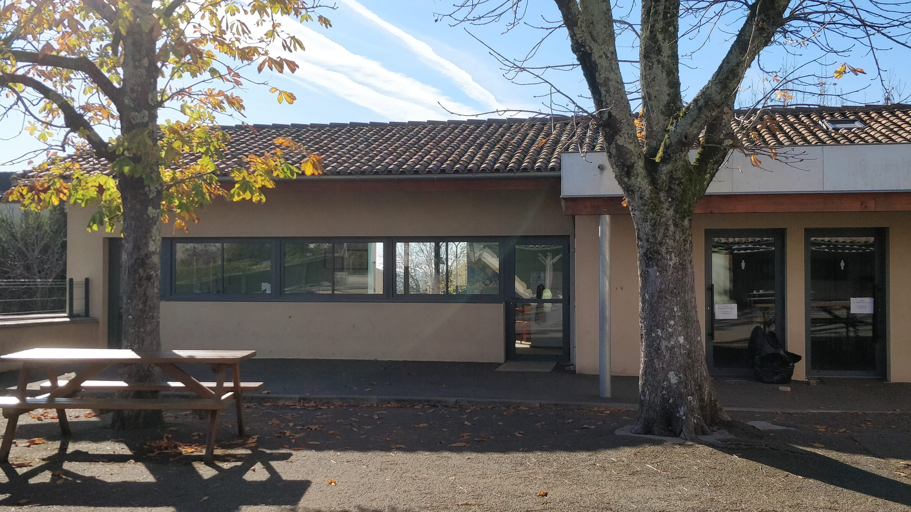
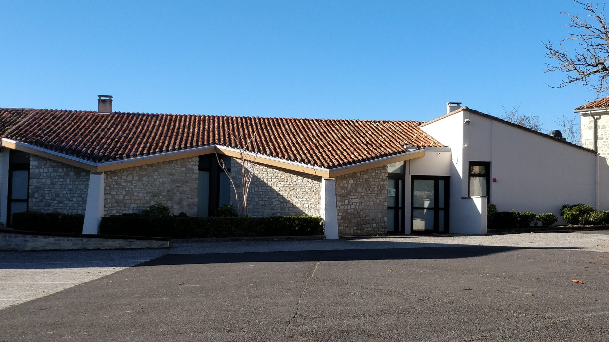
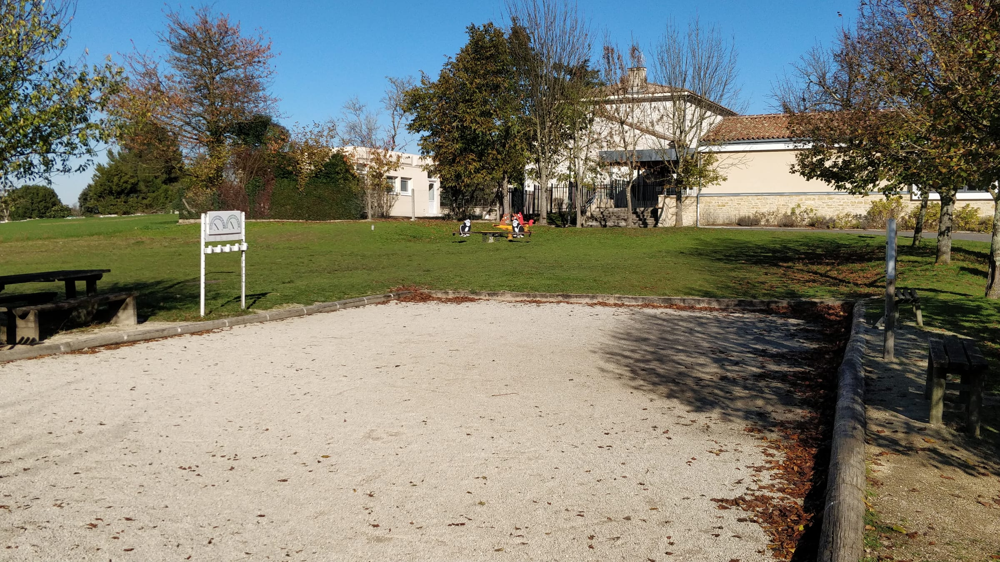
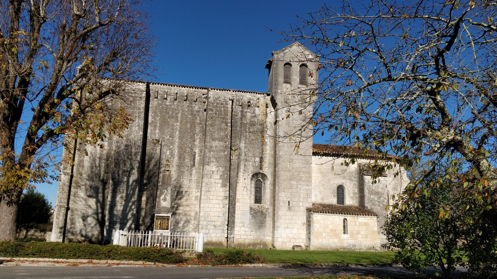
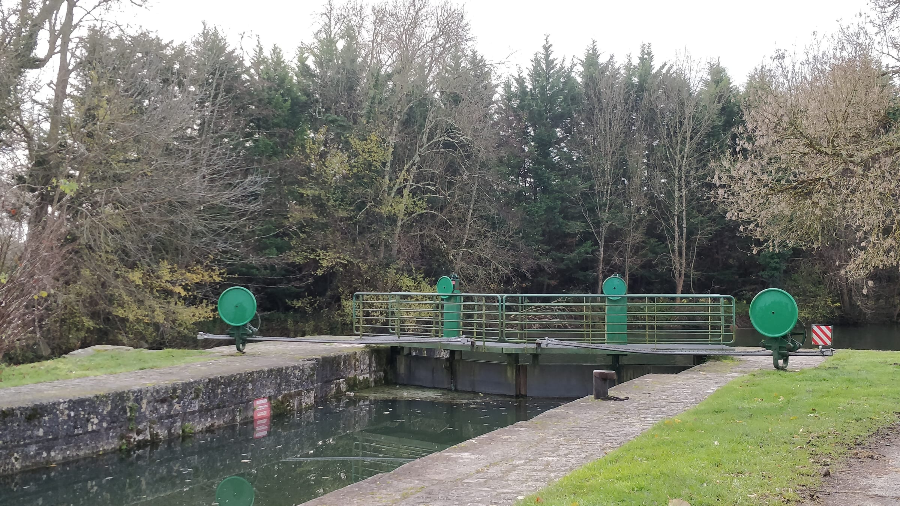

Champmillon s'étend du sud au nord entre la **Charente**, en aval d'Angoulême, et les abords d'Hiersac, à 12 km à l'ouest d'Angoulême. Le bourg réunit plusieurs hameaux : la mairie et l'église au sud, la Pille et l'école au centre, le Levraud, le Raynaud, les Basses Chabannes, Chez Cagnon, la Petite et la Grande Chapelle.

## L'école

Champmillon et Trois-Palis forment un **regroupement pédagogique intercommunal (RPI)** : les plus jeunes sont accueillis à Trois-Palis, et les élèves de l'élémentaire à l'école **Les Granges**, à Champmillon, au lieu-dit la Pille.

- **Inscriptions :** à la mairie, avec le livret de famille et un justificatif de domicile.
- **Cantine et garderie :** *horaires et tarifs à compléter*

## La salle des fêtes

La salle des fêtes peut être louée par les habitants et les associations pour les fêtes de famille et les manifestations.

| Location | Habitants | Extérieurs |
| --- | --- | --- |
| Week-end | *à compléter* | *à compléter* |
| Journée en semaine | *à compléter* | *à compléter* |

Réservation auprès de la mairie. Une caution et une attestation d'assurance sont demandées.

## Loisirs

- **Aire de jeux** pour les enfants, en accès libre.
- **Terrain de pétanque**, avec bancs et tables de pique-nique.
- **Boîte à livres** : prenez un livre, déposez-en un autre.
- **Coins pique-nique** le long des chemins.

## Les associations

- **Les Amis du patrimoine de Champmillon** : entretien et mise en valeur des lavoirs. *Contact à compléter.*
- **Comité des fêtes** : *à compléter*
- **Association des parents d'élèves** : *à compléter*
- **Société de chasse** : *à compléter*

Vous animez une association ? Envoyez à la mairie un court texte de présentation, une photo et un contact : nous l'ajouterons ici.

## Histoire

Le nom du village apparaît dès **852** sous la forme *Camelon*, puis *Campo Milonis* au XIVe siècle : le « champ de Milon », du latin *campus* et d'un personnage franc nommé Milon.

Au Moyen Âge, les habitants devaient offrir chaque année un repas au comte d'Angoulême et à sa suite. En 1240, Hugues X de Lusignan et Isabelle Taillefer transformèrent ce droit en une rente de 60 sous. L'historien **François Vigier de la Pile**, auteur d'une *Histoire de l'Angoumois*, est né au domaine de la Pille en 1687.

## L'église Saint-Vincent

Construite au **XIIe siècle**, l'église romane Saint-Vincent est **classée monument historique depuis 1904**. Curiosité : le **méridien de Greenwich** passe à une quarantaine de mètres à l'est de l'église.

## Les lavoirs

Champmillon compte deux lavoirs communaux, celui du **bourg** et celui de **la Pille**. Ils datent probablement du milieu du XIXe siècle : après l'épidémie de choléra de 1849, la loi du 3 février 1851 encourage leur aménagement. Chacun est installé près d'une source captée.

Le linge, bouilli la veille à la maison dans de grandes cuves appelées **ponnes**, était apporté en brouette pour être rincé. À genoux sur les dalles inclinées vers l'eau, les femmes le battaient avec un **battoir** en bois, puis le posaient sur la **pierre de stockage** avant de repartir vers le séchage. Deux fois par an avait lieu la grande lessive, la **bugée** en occitan. Les lavoirs ont servi jusqu'en **1970**, avec l'arrivée de l'eau courante.

Le lavoir du bourg est le plus complet : deux réservoirs, une fontaine, une pompe à main, une table de battage et une pierre de stockage. Celui de la Pille, petit et pittoresque, est accompagné d'une fontaine surmontée d'un édicule maçonné.

## Vignes et paysages

La commune occupe un plateau calcaire d'environ 80 m d'altitude, entaillé de combes et bordé au sud par la vallée de la Charente. Champmillon est classée dans les **Fins Bois**, l'un des crus de l'appellation **Cognac**.

## La Charente

Au sud de la commune, la Charente coule entre les saules. La **halte de la Liège** et son **écluse** sont un lieu de promenade et une étape pour les bateaux de plaisance.

*Balades à compléter : boucle des lavoirs, bords de Charente... avec distance, durée et point de départ.*

---

*Sources : Wikipédia, Insee, panneau du lavoir du bourg.*
